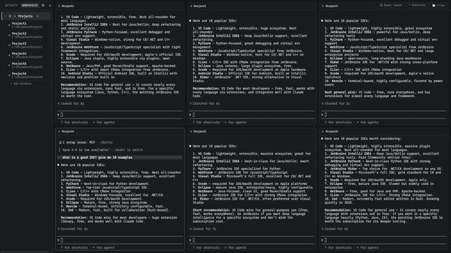

# ittop: Claude Code Desktop App for Windows

[](LICENSE)
[](#prerequisites)



**ittop is a free, open-source Claude Code desktop app for Windows.** Run and manage multiple
parallel [Claude Code](https://claude.com/claude-code) sessions, built for **vibe coding** across
several projects (or several agents on the same project) at once, without juggling a dozen
terminal windows or a `tmux`/terminal multiplexer setup by hand. Group your terminals into named
**Workspaces**, watch live status for every session, get a desktop notification the moment one is
waiting on you, and preview project files without leaving the app.

Runs natively on Windows via [ConPTY](https://learn.microsoft.com/en-us/windows/console/creating-a-pseudoconsole-session).
**No WSL, no tmux, no cloud account required.** Everything is local: your sessions, your
project paths, your data.

## Why ittop over a tmux-based session manager or a hosted GUI

Most Claude Code / AI coding agent session managers fall into one of two camps: a `tmux`-wrapping
TUI (great if you already live in a Unix terminal, awkward to set up on native Windows), or a
hosted/commercial GUI with cloud sync and subscription tiers. ittop is neither:

- **Actually native to Windows**: real ConPTY processes, no WSL layer, no Unix terminal emulator
  pretending to be a Windows app.
- **Workspaces of Terminals, not just tabs**: group related sessions (frontend + backend + docs
  agent, or five clients' repos) under one named Workspace that opens them all tiled together.
- **A file explorer built in**: browse and preview (Markdown rendered, HTML rendered sandboxed)
  whatever project a focused terminal is pointed at, without alt-tabbing to VS Code.
- **100% local and free**: MIT-licensed, no telemetry, no account, no cloud sync. Your
  `workspaces.json` never leaves your machine.

## Features

- **Workspaces containing Terminals**: a Workspace is a named group (e.g. one per project or
  client); each Workspace holds any number of Terminals (own project folder + start command).
  Opening a Workspace tiles all its Terminals together; other Workspaces keep running in the
  background, mounted but hidden, so switching back never loses scrollback or restarts a session.
- **Real terminals**: each Terminal gets its own `node-pty` process (ConPTY on Windows),
  rendered with `xterm.js`. 10,000 lines of scrollback, copy/paste that actually works inside
  Claude Code's own UI, `Ctrl+F` in-terminal search, drag-to-reorder panes, resizable columns.
- **Status detection**, via two independent signals:
  1. OSC 9 / OSC 777 "attention" escape sequences parsed straight out of the PTY stream.
  2. A tiny localhost HTTP server that Claude Code's `Notification` / `Stop` hooks POST to
     (see [Setting up Claude Code hooks](#setting-up-claude-code-hooks) below).

  Sidebar ring: 🔵 blue = waiting for input · 🟢 pulsing green = working · ⚪ grey = idle/done.
  A Windows notification fires on "waiting for input" whenever the app isn't focused, and
  unread events show as a badge count until you open the workspace.
- **Built-in file explorer**: a collapsible, lazily-loaded file tree scoped to whichever
  Terminal has focus, with a read-only preview. Markdown renders formatted, HTML renders
  sandboxed (no scripts) like a real page, everything else as plain text. Pop any preview out
  into its own resizable window.
- **Keyboard shortcuts**: `Ctrl+1`…`Ctrl+9` jump to a Workspace, `Ctrl+N` new Workspace,
  `Ctrl+K` command palette, arrow keys to cycle Workspaces.
- **5 themes** (Dark, Light, Dracula, Nord, Solarized), full settings + Workspace backup/restore
  (export/import as JSON), auto-updates via GitHub Releases.
- On restart, you're asked whether to relaunch the previously active session (Claude Code
  sessions don't survive an app restart).

## Prerequisites

- Windows 10/11
- [Node.js](https://nodejs.org/) 18 or newer
- [Claude Code CLI](https://claude.com/claude-code) installed and on your `PATH` (the default
  start command for a new workspace is `claude`)
- Git (optional, only needed for the branch indicator in the sidebar)

`node-pty` ships prebuilt native binaries (N-API, ABI-stable) for `win32-x64`/`win32-arm64`,
so a normal `npm install` works out of the box. **No Visual Studio Build Tools required** for
everyday use. You'd only need them if you ever have to compile `node-pty` from source (see
[Troubleshooting](#troubleshooting)).

## Getting started

```bash
npm install
npm run dev      # starts the app in development mode with hot reload
```

To run a production-style build without packaging an installer:

```bash
npm run build
npm start
```

To build a distributable Windows installer (NSIS `.exe`):

```bash
npm run build:win
```

The output lands in `dist/` (e.g. `dist/ittop-1.0.0-setup.exe`). Building the
installer does **not** require Visual Studio Build Tools either: `electron-builder.yml` sets
`npmRebuild: false` since `node-pty`'s N-API prebuilds are already ABI-compatible with Electron.

## Setting up Claude Code hooks

The hook path is the more reliable of the two status signals (OSC codes depend on what the
CLI/tools inside your session choose to emit). To wire it up:

1. Start the app once. It opens a local HTTP listener on `127.0.0.1:47823`.
2. Open your Claude Code settings (global `~/.claude/settings.json`, or a project's
   `.claude/settings.json`) and merge in the following hooks. They forward Claude Code's own
   hook JSON straight to the app on stdin, unmodified, via `curl.exe` (ships with Windows 10+):

```json
{
  "hooks": {
    "Notification": [
      {
        "matcher": "",
        "hooks": [
          {
            "type": "command",
            "command": "curl.exe -s -X POST -H \"Content-Type: application/json\" --data-binary @- --max-time 2 http://127.0.0.1:47823"
          }
        ]
      }
    ],
    "Stop": [
      {
        "matcher": "",
        "hooks": [
          {
            "type": "command",
            "command": "curl.exe -s -X POST -H \"Content-Type: application/json\" --data-binary @- --max-time 2 http://127.0.0.1:47823"
          }
        ]
      }
    ]
  }
}
```

> Older instructions used an inline PowerShell one-liner with `$json`/`$body` variables to
> remap the payload before sending it. Don't do that: Claude Code runs hook commands through
> Git Bash on Windows, which expands `$json`/`$body` to nothing before PowerShell ever sees
> them, silently breaking the hook. The `curl` command above avoids the problem entirely by
> not needing any shell variables. ittop reads Claude Code's raw hook field names
> (`hook_event_name`, `cwd`, `message`) directly.

3. That's it. Restart your Claude Code session inside a workspace and the sidebar status ring
   will react to real `Notification`/`Stop` events instead of relying only on OSC parsing.

The app matches an incoming hook event to a workspace by comparing `projectPath` (the hook's
`cwd`) against each workspace's configured project folder, so make sure the workspace's folder
matches the directory you actually run `claude` from.

## Keyboard shortcuts

| Shortcut          | Action                                    |
| ------------------ | ----------------------------------------- |
| `Ctrl+1`–`Ctrl+9`  | Jump to workspace 1–9                     |
| `Ctrl+N`           | New workspace dialog                      |
| `Ctrl+K`           | Command palette                           |
| `↑` / `↓`          | Cycle workspaces (outside a terminal)     |
| `Ctrl+F`           | Search inside the focused terminal        |
| `?`                | Show all shortcuts                        |

## Architecture

```
src/
  main/       Electron main process: PTY manager, status manager, OSC parser,
              localhost hook server, git branch poller, JSON persistence, IPC handlers.
  preload/    contextBridge API exposed to the renderer as window.api.
  renderer/   React UI: Sidebar, TerminalPane (xterm.js), FileExplorer/PreviewWindow,
              workspace/terminal dialogs, zustand store.
  shared/     Types and IPC channel names shared between main/preload/renderer.
```

PTY processes only ever live in the main process; the renderer talks to them exclusively
through the IPC channels defined in `src/shared/types.ts`. On app quit, all PTY process trees
are killed via `tree-kill` so no orphaned `claude` processes are left running.

## Releasing

Pushing a tag matching `v*` (e.g. `v1.1.0`) runs [`.github/workflows/release.yml`](.github/workflows/release.yml),
which builds the Windows installer and publishes it as a GitHub Release. `electron-updater`
(wired up in Settings → Check for updates) reads that release feed, so once one is published
every installed copy of ittop can update to it automatically.

## Troubleshooting

- **Nothing happens when I create a workspace**: make sure the start command (`claude` by
  default) is resolvable from a plain PowerShell in that folder; try running it manually first.
- **Git branch doesn't show up**: the sidebar polls `git rev-parse --abbrev-ref HEAD` every
  5 seconds; this silently returns nothing for folders that aren't git repositories.
- **`node-pty` fails to load a native module**: this should not happen with the bundled
  prebuilt binaries. If you're on an unsupported architecture and need to compile from source,
  install the "Desktop development with C++" workload via Visual Studio Build Tools, then run
  `npx electron-rebuild -f -w node-pty`.
- **No desktop notifications**: Windows notifications are suppressed while the app window is
  focused, and require Windows notifications to be enabled for the app in Windows Settings.

## License

[MIT](LICENSE): free for personal and commercial use, no warranty. ittop is an independent,
unofficial tool and isn't affiliated with or endorsed by Anthropic.
